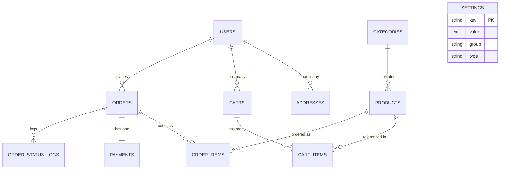
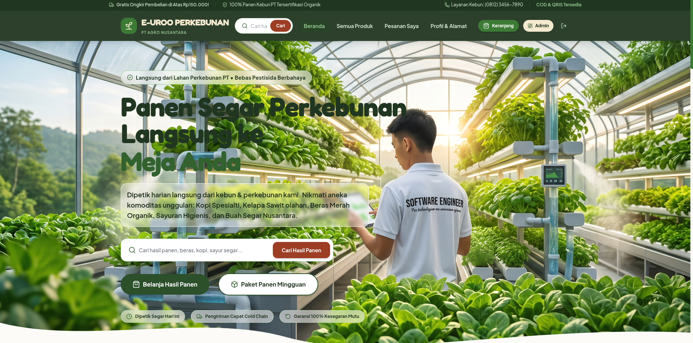
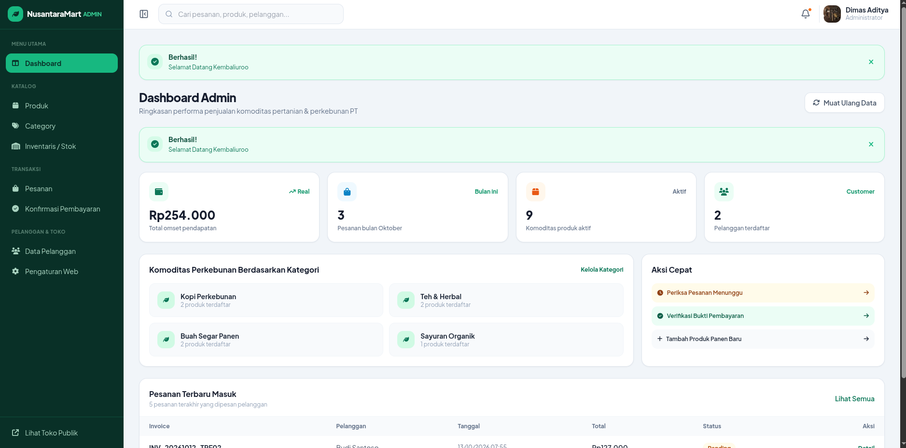
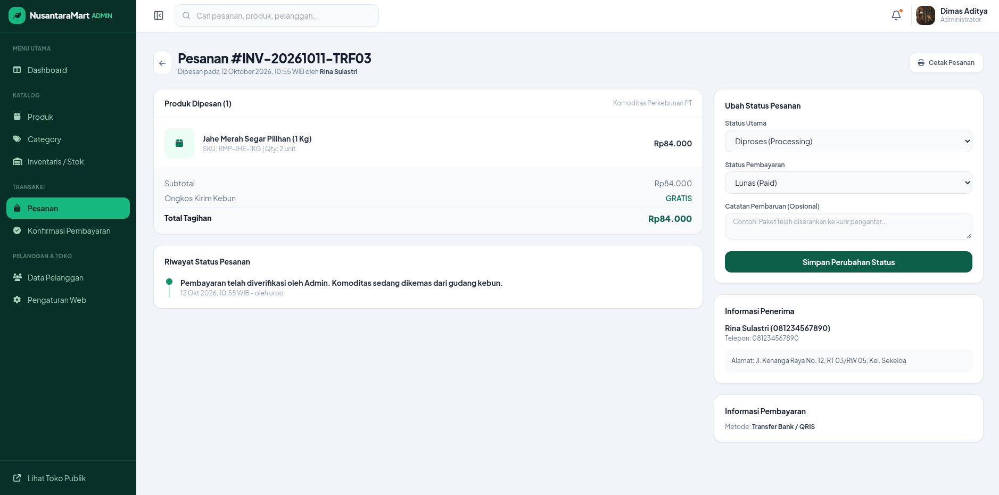

# E-UROO Agro Commerce

[](https://laravel.com)
[](https://php.net)
[](https://tailwindcss.com)
[](https://mysql.com)
[](https://phpunit.de)

Platform e-commerce B2C hasil pertanian dan perkebunan terintegrasi berskala korporat (PT Agro). Dibangun dengan fokus pada **kinerja tinggi**, **keamanan transaksi**, **pencegahan N+1 query**, serta antarmuka modern bernuansa *organic agriculture store*.

Live Demo: [https://uroo-commerce.uroo.my.id](https://uroo-commerce.uroo.my.id)  
Repository: [https://github.com/uroo-dev/uroo-commerce](https://github.com/uroo-dev/uroo-commerce)

---

## Daftar Isi
- [Gambaran Umum](#gambaran-umum)
- [Akun Demo](#akun-demo)
- [Fitur Utama](#fitur-utama)
- [Keunggulan Arsitektur & Rekayasa Teknis](#keunggulan-arsitektur--rekayasa-teknis)
- [Tech Stack](#tech-stack)
- [Struktur Database & Relasi](#struktur-database--relasi)
- [Tangkapan Layar (Screenshots)](#tangkapan-layar-screenshots)
- [Instalasi Lokal](#instalasi-lokal)
- [Pengujian Otomatis (Testing)](#pengujian-otomatis-testing)
- [Struktur Direktori](#struktur-direktori)
- [Batasan & Rencana Pengembangan](#batasan--rencana-pengembangan)
- [Tentang Pengembang](#tentang-pengembang)

---

## Gambaran Umum

**E-UROO Agro Commerce** menjembatani hasil panen langsung dari perkebunan dan pertanian milik perusahaan (*PT*) kepada konsumen akhir. 

Pengunjung dapat menjelajahi katalog komoditas unggulan secara bebas tanpa perlu login. Ketika ingin bertransaksi, pelanggan diarahkan masuk ke sistem, wajib melengkapi profil alamat pengiriman, lalu memilih metode pembayaran fleksibel: **COD (Bayar di Tempat)** atau **Transfer Bank & QRIS**. Setiap pesanan dilengkapi struk digital, bukti transfer, verifikasi admin, serta pencatatan audit log status secara transparan.

---

## Akun Demo

| Peran (Role) | Email | Password | Hak Akses |
|---|---|---|---|
| **Super Admin** | `uroo@gmail.com` | `password` | Dashboard pendapatan, katalog produk/kategori, verifikasi pembayaran, manajemen pesanan, data pelanggan, dan CMS pengaturan web |
| **Pelanggan 1** | `rina.sulastri@gmail.com` | `password` | Katalog belanja, keranjang, checkout COD/QRIS, struk digital, manajemen alamat |
| **Pelanggan 2** | `budi.santoso@gmail.com` | `password` | Riwayat transaksi transfer, pelacakan pesanan, upload bukti bayar |

> **Catatan**: Akun demo dihasilkan melalui database seeder (`DatabaseSeeder.php`). Jangan gunakan kredensial demo ini di lingkungan *production*.

---

## Fitur Utama

### 🛒 Pelanggan (Customer)
- **Katalog & Navigasi Organik**: Pencarian instan dan filter kategori komoditas panen segar harian.
- **Keranjang Belanja Real-Time**: Manajemen item keranjang dengan counter indikator dinamis.
- **Validasi Checkout Terproteksi**: Guard wajib login dan validasi alamat pengiriman aktif sebelum checkout.
- **Metode Pembayaran Ganda**:
  - **COD (Cash on Delivery)**: Pemesanan instan langsung proses ke pengemasan kebun.
  - **Transfer Bank / QRIS**: Generate kode QR pembayaran otomatis dengan formulir unggah bukti transfer.
- **Struk Digital & Pelacakan**: Cetak/lihat invoice digital resmi berformat `ORD-YYYYMMDD-XXXXX` beserta catatan timeline status pesanan.
- **Manajemen Profil & Multi-Alamat**: Tambah, ubah, dan set alamat default pengiriman.

### 🛡️ Administrator (PT Management)
- **Dashboard Ringkasan Operasional**: Statistik total pendapatan, pesanan baru, produk aktif, dan total pelanggan.
- **Manajemen Katalog Produk**: CRUD produk lengkap dengan slug otomatis, SKU, stok, berat pengiriman, dan upload gambar produk.
- **Manajemen Kategori Komoditas**: CRUD kategori panen dengan kontrol status visibilitas menu publik.
- **Pemrosesan Pesanan (Order Pipeline)**: Perubahan status transparan (`pending` ➔ `processing` ➔ `shipped` ➔ `completed` / `cancelled`).
- **Verifikasi Pembayaran Transfer**: Review bukti transfer yang diunggah pelanggan, persetujuan pembayaran (*approve/reject*), dan pencatatan nama admin verifikator.
- **Audit Log Status**: Setiap perubahan status pesanan tercatat di `order_status_logs` lengkap dengan catatan internal dan penanggung jawab (*changed_by*).
- **CMS Pengaturan Tampilan Web**: Kustomisasi nama brand toko, tagline PT, logo gambar, promo top bar, teks/background hero banner, media sosial, dan kata-kata di footer secara mandiri dari panel admin.

---

## Keunggulan Arsitektur & Rekayasa Teknis

1. **Pencegahan Double-Payment & Race Condition**:
   - Menggunakan **Database Transaction** (`DB::transaction`) dan **Pessimistic Locking** (`lockForUpdate()`) pada proses checkout dan verifikasi pembayaran guna mencegah duplikasi pesanan saat tombol ditekan berulang kali (*spam click*).
2. **Pencegahan Masalah N+1 Query**:
   - Seluruh pemanggilan relasi Eloquent dioptimalkan menggunakan *Eager Loading* (`with(['category', 'items.product', 'payment', 'address'])`) dan agregasi `withCount()`.
3. **Indexing Database Strategis**:
   - Indexing komprehensif pada kolom `slug`, `sku`, `is_active`, `status`, `order_number`, serta seluruh *foreign keys* guna menjamin waktu respons query tetap optimal saat volume data bertumbuh.
4. **Sistem Pengaturan Web Berkinerja Tinggi (Cached Settings)**:
   - Pengaturan website disimpan dalam tabel `settings` dan di-cache permanen di memory (`Cache::rememberForever`). Cache otomatis di-*flush* saat admin memperbarui pengaturan.
5. **Gated Checkout Workflow**:
   - Mencegah pesanan fiktif tanpa alamat: Sistem memvalidasi ketersediaan alamat pelanggan secara ketat dan mengarahkan pengguna melengkapi data alamat terlebih dahulu.
6. **Clean Code & Strict Form Validation**:
   - Menggunakan validasi ketat, controller ramping (*thin controller*), penanganan *try-catch* pada operasi sensitif, serta lolos standar penulisan **Laravel Pint**.

---

## Tech Stack

- **Backend**: PHP 8.3+, Laravel 13 Framework
- **Database**: MySQL 8.0 / MariaDB 10.11
- **Frontend**: Blade Templating, Tailwind CSS (Custom Harvest & Earth Palette), Lucide Icons, FontAwesome 6, AOS (Animate on Scroll)
- **Autentikasi & Otorisasi**: Laravel Session Auth, Role-based Middleware (`role:admin`)
- **Code Style & Quality**: Laravel Pint Code Formatter
- **Testing**: PHPUnit / Laravel Feature Testing Suite

---

## Struktur Database & Relasi



### Relasi Kunci:
- `users ➔ addresses`: Relasi 1-ke-banyak untuk opsi alamat tujuan pengiriman.
- `carts ➔ cart_items ➔ products`: Keranjang belanja persisten yang terikat ke akun pengguna.
- `orders ➔ order_items`: Snapshot harga dan kuantitas saat transaksi terjadi (*historical price integrity*).
- `orders ➔ payments`: Status transaksi, metode pembayaran (COD/Transfer), dan bukti transfer.
- `orders ➔ order_status_logs`: Histori jejak audit perubahan status pesanan.

---

## Tangkapan Layar (Screenshots)

### 🌿 1. Halaman Utama Publik (Landing Page)
Tampilan hero section bertema perkebunan organik dengan teks berbobot kontras tinggi dan pencarian komoditas panen instan:


### 📊 2. Dashboard Administrator
Metrik pendapatan, ringkasan transaksi, serta navigasi manajemen toko:


### 📦 3. Manajemen & Verifikasi Pesanan Admin
Tabel pemantauan pesanan pelanggan, filter status, dan aksi verifikasi bukti transfer:


---

## Instalasi Lokal

### Prasyarat
- PHP >= 8.3 (dengan ekstensi `pdo_mysql`, `mbstring`, `fileinfo`, `gd`)
- Composer >= 2.x
- MySQL >= 8.0 atau MariaDB >= 10.6
- Node.js >= 18.x dan npm

### Langkah-langkah

```bash
# 1. Clone repository
git clone https://github.com/uroo-dev/uroo-commerce.git
cd uroo-commerce

# 2. Pasang dependensi PHP & Node
composer install
npm install

# 3. Konfigurasi file environment
cp .env.example .env
php artisan key:generate

# 4. Sesuaikan konfigurasi database di .env
# DB_CONNECTION=mysql
# DB_HOST=127.0.0.1
# DB_PORT=3306
# DB_DATABASE=e-uroo_db
# DB_USERNAME=root
# DB_PASSWORD=

# 5. Jalankan migrasi dan data seeder
php artisan migrate --seed

# 6. Buat symbolic link storage
php artisan storage:link

# 7. Jalankan build aset dan web server
npm run build
php artisan serve
```

Buka peramban Anda di: **`http://127.0.0.1:8000`**

---

## Pengujian Otomatis (Testing)

Proyek ini dilengkapi dengan *Feature Tests* lengkap yang menguji alur bisnis dari sisi pengguna maupun admin:

```bash
php artisan test
```

### Cakupan Pengujian:
- ✅ Penelusuran publik katalog & produk tanpa login.
- ✅ Pembatasan akses *Guest* dari keranjang dan checkout.
- ✅ *Gating* alamat pengiriman sebelum pembuatan pesanan.
- ✅ Alur checkout metode COD dan pembuatan nomor invoice unik.
- ✅ Alur checkout metode Transfer/QRIS dan upload bukti bayar.
- ✅ Verifikasi pembayaran dan persetujuan pesanan oleh administrator.
- ✅ Pencegahan akses pengguna non-admin ke panel CMS dan pengaturan sistem.
- ✅ Pembaruan pengaturan website (CMS) serta pengunggahan logo/hero banner.

---

## Struktur Direktori

```text
e-uroo/
├── app/
│   ├── Helpers/             # Helper fungsi global (e.g. setting())
│   ├── Http/
│   │   ├── Controllers/
│   │   │   ├── Admin/       # Category, Product, Order, Payment, Customer, Setting
│   │   │   ├── Auth/        # Login, Register, Logout
│   │   │   └── Public/      # Home, Product, Cart, Checkout, Order, Profile, Payment
│   │   └── Middleware/      # Role-based middleware & HTTP guards
│   ├── Models/              # User, Product, Category, Order, Payment, Setting, dll.
│   └── Providers/
├── database/
│   ├── migrations/          # Skema tabel, foreign keys, & performance indexes
│   └── seeders/             # DatabaseSeeder & SettingSeeder (Demo Data)
├── public/
│   └── asset/               # Tangkapan layar proyek & aset media
├── resources/
│   └── views/
│       ├── Admin/           # Dashboard, Katalog, Pesanan, Pembayaran, Settings
│       └── Public/          # Landing Page, Katalog, Checkout, Struk Digital, Profil
├── routes/
│   └── web.php              # Rute terproteksi role & rute publik
└── tests/
    └── Feature/             # Automated Feature Tests (Checkout & Settings)
```

---

## Batasan & Rencana Pengembangan

- **Payment Gateway Otomatis**: Integrasi Midtrans / Xendit untuk verifikasi pembayaran tanpa cek manual.
- **Integrasi Ongkos Kirim**: Penambahan API RajaOngkir untuk perhitungan tarif kurir berbasis berat komoditas.
- **Notifikasi Multi-Channel**: Pengiriman invoice otomatis melalui WhatsApp API dan Email (SMTP).

---

## Tentang Pengembang

**Dimas Euro Dwi Prasetyo**  
*Full-Stack Laravel Developer | UROO.DEV*  
- **GitHub**: [github.com/uroo-dev](https://github.com/uroo-dev)  
- **Portfolio**: [uroo.my.id](https://uroo.my.id)  
- **Email**: `uroodev@gmail.com`
